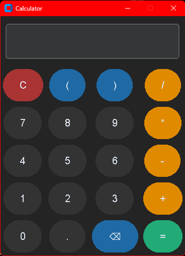

# SleekCalc

  

SleekCalc is a nice, modern calculator app for your PC or Mac. It's minnimal, but fully functional.

## Requirements

 - Python 3.9 or newer
 - Customtkinter

## Configurations

Edit `configs.py` to change the look of the app:

| Setting | Description |
|---|---|
| `APPEARANCE` | `"dark"`, `"light"`, or `"system"` |
| `THEME` | CustomTkinter color theme, e.g. `"blue"` |
| `WINDOW_TITLE` | Title shown in the window bar |
| `WINDOW_SIZE` | Window size, e.g. `"320x460"` |
| `FONT` | Font family used for the display and buttons |

## Installation (For Windows)

1. Go to the `Releases` tab and select the latest release
2. Go to the `Assets` tab in the latest release and download the excecutable file
3. Launch the excecutable file

## License

[Apache License 2.0](LICENSE)
